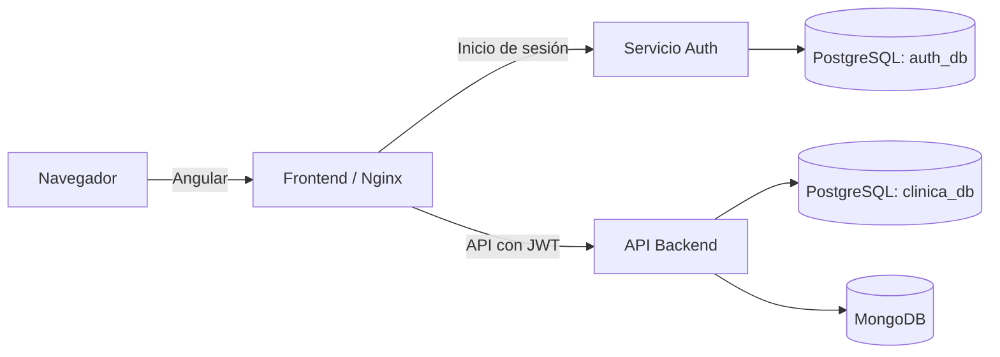

# Sistema de gestión clínica

Aplicación web para administrar pacientes, hospitales, doctores y citas. El sistema separa la interfaz, la API de negocio y el servicio de autenticación, y dispone de una configuración de Docker Compose para los servicios principales.

## Componentes

| Carpeta | Descripción | Tecnologías |
| --- | --- | --- |
| [`Frontend/`](./Frontend/README.md) | Interfaz web y navegación de la aplicación | Angular 22, TypeScript |
| [`Backend/`](./Backend/README.md) | API de gestión clínica y acceso a datos | Java 17, Spring Boot, PostgreSQL, MongoDB |
| [`Auth/`](./Auth/README.md) | Registro, inicio de sesión y emisión de tokens JWT | Java 17, Spring Boot, PostgreSQL, RSA |
| [`Docker/`](./Docker/) | Dockerfiles, configuración de Nginx y Docker Compose | Docker |
| [`docs/`](./docs/) | Documentación técnica y material del proyecto | PDF, Markdown |
| [`proyecto-enrutador/`](./proyecto-enrutador/) | Práctica web de navegación entre páginas | HTML, CSS, JavaScript |
| [`proyecto-juego/`](./proyecto-juego/) | Práctica web de juego | HTML, CSS, JavaScript |
| [`practica1/`](./practica1/) | Ejercicios iniciales de backend | Java |

## Arquitectura



El servicio de autenticación emite los JWT firmados con una llave privada RSA. El backend valida los tokens usando la llave pública y aplica autorización por roles.

## Requisitos

- Docker Desktop con Docker Compose, para ejecutar los servicios en contenedores.
- Java 17 y Maven, para ejecutar o compilar `Backend` y `Auth` localmente.
- Node.js y npm, para desarrollar o compilar `Frontend`. La imagen Docker del frontend usa Node.js 24.

## Ejecución con Docker Compose

Desde la raíz del repositorio:

```bash
docker compose -f Docker/docker-compose.yml up --build -d
docker compose -f Docker/docker-compose.yml ps
docker compose -f Docker/docker-compose.yml logs -f backend
docker compose -f Docker/docker-compose.yml down
```

Puertos publicados en la configuración actual:

| Servicio | Puerto del host |
| --- | ---: |
| Frontend | 80 |
| Backend | 8080 |
| Auth | 8081 |
| PostgreSQL | 5432 |
| MongoDB | 27017 |

La base PostgreSQL de desarrollo se inicializa con `Docker/init-dbs.sql`. Las credenciales y demás valores de entorno locales están definidos en `Docker/docker-compose.yml`; cámbialos antes de usar la configuración fuera de un entorno de desarrollo.

### Configuración de las API

Las direcciones de las API del frontend están definidas en `Frontend/src/environments/environment.ts` y `environment.prod.ts`. Actualmente ambas apuntan a los servicios publicados en Render. Para que el frontend use servicios locales, actualiza esas direcciones y vuelve a construir la aplicación. Desde el navegador se usan direcciones accesibles desde el host (por ejemplo, `localhost`), no los nombres DNS internos de Docker.

Además, el puerto del contenedor Auth debe coincidir con el puerto destino publicado en `Docker/docker-compose.yml`. Auth escucha en `8081` por defecto; revisa esa correspondencia si el servicio no responde en el puerto host `8081`.

## Ejecución local

Cada aplicación tiene instrucciones específicas:

- [Frontend: instalación, desarrollo y compilación](./Frontend/README.md)
- [Backend: configuración, endpoints y ejecución](./Backend/README.md)
- [Auth: configuración, endpoints y ejecución](./Auth/README.md)

Para conectarlas localmente, configura las variables de entorno de PostgreSQL y las URL de las API para que coincidan con los puertos de los servicios que estés ejecutando.

## Acceso a PostgreSQL en Docker

Para abrir una consola de PostgreSQL en la base clínica:

```bash
docker exec -it postgres_db psql -U admin -d clinica_db
```

El esquema de las tablas de las aplicaciones debe estar disponible en sus bases de datos antes de iniciar los servicios que validan el esquema.
